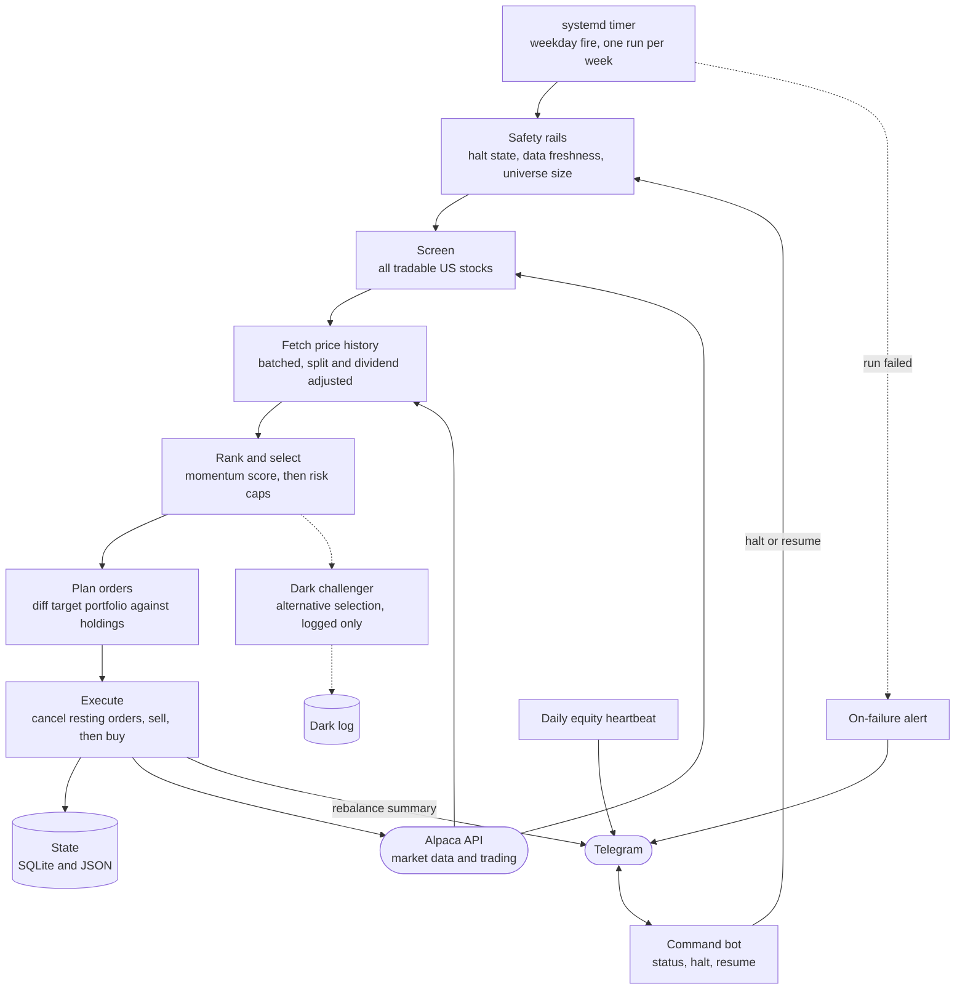
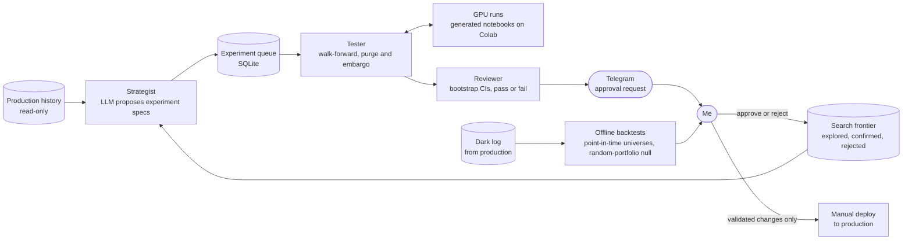

# Trading System

An autonomous equities trading system that I designed, built, and operate. It trades real money through the Alpaca API and runs unattended on a home Linux server. It has been live since May 2026.

This repo is a showcase. It covers the architecture, how I validate changes, and how I keep the system running. The strategy code is private and none of it is here.

## What it is

Once a week the system screens about 3,700 US stocks, ranks them with a momentum strategy, and rebalances into a 15-position portfolio. Nobody presses a button. A timer starts the run, the run checks its own safety rails, places the orders, and sends me a summary.

| | |
|---|---|
| Live since | May 2026 |
| Current strategy | Weekly momentum, 19 consecutive weekly rebalances since July 6, 2026 |
| Screen | ~3,700 US stocks down to 15 positions |
| Broker | Alpaca API, fractional shares |
| Tests | 316+, all runnable offline |
| Research | An LLM proposes about 7 experiment specs per week |

The first version, live in May 2026, was an hourly scanner driven by ML models. I retired it in July after my own validation work showed those models had no real edge. That story is in [The research pipeline](#the-research-pipeline). The weekly strategy replaced it and has run every week since.

I don't publish live results. The live account is a small real-money pilot, and it is too young to support any statistical claim. Every performance number in this README is a backtest result and is labeled as one.

## Architecture

There are two codebases. The production bot trades. The research pipeline proposes and tests ideas. They share no imports, and the research side reads production data read-only.

**Production bot**



**Research pipeline**



How the pieces fit:

- **Data ingestion.** Each run pulls the full list of tradable assets and daily price history from Alpaca in batches. All prices are split and dividend adjusted. Raw prices turn a stock split into a fake price move, which a momentum strategy would happily trade on.
- **Screening pipeline.** The strategy logic is a set of pure functions: screen, rank, apply risk caps, plan orders. They take data in and return decisions. That is what makes them testable without a network.
- **Execution.** The orchestrator diffs the target portfolio against current holdings, sells first, waits for settlement, then buys with each order capped by live buying power. A dry-run flag exercises the whole pipeline and places nothing.
- **Monitoring and alerting.** Every rebalance sends a Telegram summary. A separate unit alerts me if a run exits non-zero. A daily heartbeat reports that the system is alive. A command bot lets me check status or halt trading from my phone.
- **Research pipeline.** A weekly job asks an LLM for experiment specs, runs them through walk-forward validation, and sends me the ones that pass statistical review. Nothing moves from research to production automatically. I deploy validated changes by hand.

## Validation methodology

A backtest is easy to fool yourself with. These are the rules I hold changes to.

**Pre-committed gates.** I write the pass criteria before I run the experiment. After a failed run I can tighten a gate. I never loosen one.

**A 255-week point-in-time backtest.** Before the weekly strategy went live I tested it over 255 weeks, a window that includes the 2022 momentum crash. The stock universe is rebuilt each week using only data available at that date. Picking the universe with today's knowledge leaks future information into the past, and my first version of this backtest did exactly that. The corrected run produced a backtested net alpha of +51 bps per week after assumed trading costs, positive in 5 of 6 calendar years in the backtest. One known bias remains: delisted stocks are missing from the data, so I treat the backtested figure as an upper bound.

**A random-portfolio null.** A number like that means little without a baseline for luck. For every week I draw 1,000 random portfolios of the same size from the same universe and build the distribution of what chance produces. The backtested strategy landed at the 100th percentile of that null.

**Walk-forward with purge and embargo.** Anything with a trained model is tested on folds that move forward in time. Training rows whose labels overlap the validation window are purged, and an extra embargo gap follows. The model never trains on information from the period it is scored on.

**Canary tests.** Each validation run includes two deliberate sabotage checks. One shuffles the labels, and the score must fall to chance. The other shifts features into the future on purpose, and the score must jump. Together they show that the test setup can carry real signal and reports none when none exists.

**Bootstrap confidence intervals.** Fold scores are resampled 1,000 times to get a 95% interval. A result only counts as an improvement if the baseline sits outside that interval.

**Dark-running challengers.** A candidate change that carries a real cost does not ship on a backtest alone. It runs dark inside the production job: computed on live data every week, logged next to the live picks, trading nothing, and isolated so that a failure cannot abort the real run. I decide to promote or kill it from the logged evidence. One challenger is running this way now.

After reviewing live behavior in October 2026, I built a backtest comparing 11 variants of the risk controls over about 195 weeks. I shipped the one change that improved backtested risk-adjusted return at no backtested cost, retired a control that failed its test twice, and sent the most promising higher-cost variant to a dark run.

## Engineering discipline

**316+ tests, all runnable offline.** Every broker and network dependency is injected through the constructor, so tests substitute stubs. The suite passes with no credentials and no network access. 43 of those tests pin the behavior of the live strategy: selection, order planning, execution order, and each safety rail.

**Every live incident becomes a pinned regression test.** One example: the broker API added a new exchange code that the SDK's validation layer did not recognize, and the weekly run exited before trading. The newest SDK release had the same gap, so upgrading was not a fix. I changed the asset screen to read raw responses and never touch that field, then added a test with the unknown value in the fixture. That week's rebalance ran the same day, after the fix.

**A measured fix for turnover.** I added a correlation cap as a risk control and live turnover jumped. Week-to-week correlation estimates are noisy, so stocks near the threshold flapped in and out of the portfolio, and each round trip cost money. I measured it from the live trade log: 6.0 round trips per week. The fix was hysteresis. A position already held is exempt from the entry check and leaves only through the normal exit rules. Turnover fell to 3.3 round trips per week, measured over the following weeks, and a later backtest confirmed the effect.

**Built to run unattended.**

- The timer fires every weekday, and the job gates itself to one rebalance per week. A holiday or a failed run is retried on the next fire with no special handling.
- Pre-trade checks abort the run if the data is stale or the universe is too small. Circuit breakers halt all trading until I clear them by hand.
- A dry-run mode runs the real pipeline against live data and writes no orders and no state.
- Logs rotate weekly.

## The research pipeline

The research side runs in three stages on a schedule.

1. **Strategist.** Once a week, an LLM (Claude, through the Anthropic API) reads the history of past experiments and a search-frontier file that tracks which ideas are explored, confirmed, or rejected. It returns about 7 experiment specs through a tool-use schema that forces structured output. LLMs still invent parameter names sometimes, so an alias layer maps the common mistakes onto the real ones.
2. **Tester.** Each spec becomes a walk-forward run. Experiments that need a GPU are compiled into self-contained notebooks, uploaded to Google Drive, run on Colab, and their results are polled back and imported.
3. **Reviewer.** Results get bootstrap confidence intervals and a classification. Strong passes reach me on Telegram with approve and reject buttons. My decision updates the search frontier, which shapes next week's specs.

**The leak.** The first version of this system traded on ML models with validation AUCs as high as 0.78. I ran 42 experiments through the pipeline to improve them. Then a review of the feature code found a look-ahead leak: intraday rows were being joined to that same day's completed daily bar, so the model could see the close before it happened. I fixed the join and reran validation. Every model fell to chance, with AUCs between 0.48 and 0.54. All 42 experiments had been measuring the leak.

I retired those models and the scanner that used them. The capital at risk had been small by design, and the models had rarely been confident enough to trade.

The validation rules in the section above came out of that failure. The peek canary exists to catch that exact class of bug. The first experiment under the new rules was a larger ML ranking model. It failed its pre-committed gate, and I did not deploy it. Later I built a slot in the production bot for an ML model that could veto picks. The model I trained for it scored a walk-forward AUC of 0.497, so the slot is still empty.

## Sample output

A live weekly rebalance from November 2026, start to finish in about two minutes. Symbols, scores, account values, order sizes, order IDs, and pool sizes are redacted. The file is in [docs/sample-rebalance-log.txt](docs/sample-rebalance-log.txt).

```text
08:45:00 | INFO    | execution_alpaca:__init__ - Alpaca executor initialized (LIVE)
08:45:03 | INFO    | momentum_rebalancer:screen_candidates - Screen: 3729 candidate symbols
08:46:37 | INFO    | momentum_rebalancer:screen_candidates - Screen: [n] symbols pass liquidity/price filters
08:46:56 | INFO    | momentum_rebalancer:fetch_deep_closes - Deep fetch: [n] days x [n] symbols
08:46:56 | INFO    | momentum_rebalancer:run - sector breakdown: [redacted]
08:46:56 | INFO    | momentum_rebalancer:run - dark challenger picks: [15 symbols redacted] | overlap with live [n]/15
08:46:57 | INFO    | momentum_rebalancer:run - regime (info only): [redacted]
08:46:57 | INFO    | momentum_rebalancer:run - week=2026-W46 equity=[redacted] universe=[n] held=[15 symbols redacted]
08:46:57 | INFO    | momentum_rebalancer:run - picks: [15 symbols and scores redacted]
08:46:57 | INFO    | momentum_rebalancer:run - plan: SELL [3 symbols redacted] | BUY [3 symbols and amounts redacted]
08:46:57 | INFO    | execution_alpaca:close_position - Closed position in [symbol]
08:46:57 | INFO    | momentum_rebalancer:_sell -   SOLD [symbol]
08:46:57 | INFO    | execution_alpaca:close_position - Closed position in [symbol]
08:46:57 | INFO    | momentum_rebalancer:_sell -   SOLD [symbol]
08:46:57 | INFO    | execution_alpaca:close_position - Closed position in [symbol]
08:46:57 | INFO    | momentum_rebalancer:_sell -   SOLD [symbol]
08:47:03 | INFO    | execution_alpaca:place_market_order - Market buy [qty] [symbol] -> [order id]
08:47:03 | INFO    | execution_alpaca:place_market_order - Market buy [qty] [symbol] -> [order id]
08:47:03 | INFO    | execution_alpaca:place_market_order - Market buy [qty] [symbol] -> [order id]
08:47:04 | INFO    | momentum_rebalancer:run - Rebalance 2026-W46 complete: 3 sells, 3 buys
```

## Stack

Python 3.12, pandas, NumPy, LightGBM, PyTorch, pytest, SQLite, loguru, systemd units and timers, Alpaca trading and market data APIs, Anthropic API, Telegram Bot API, Google Drive API, Google Colab.

## License

The contents of this repo are released under the [MIT License](LICENSE).
